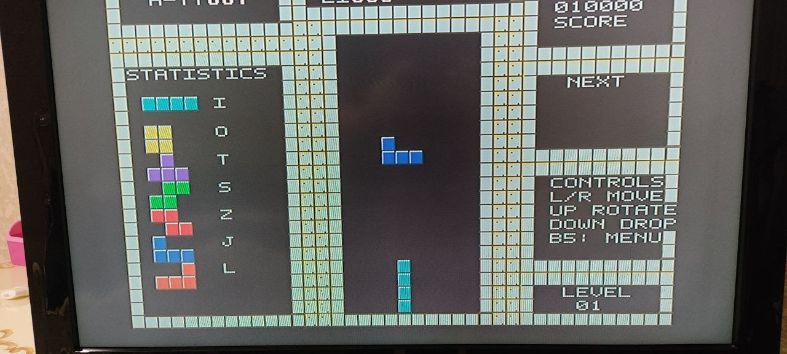
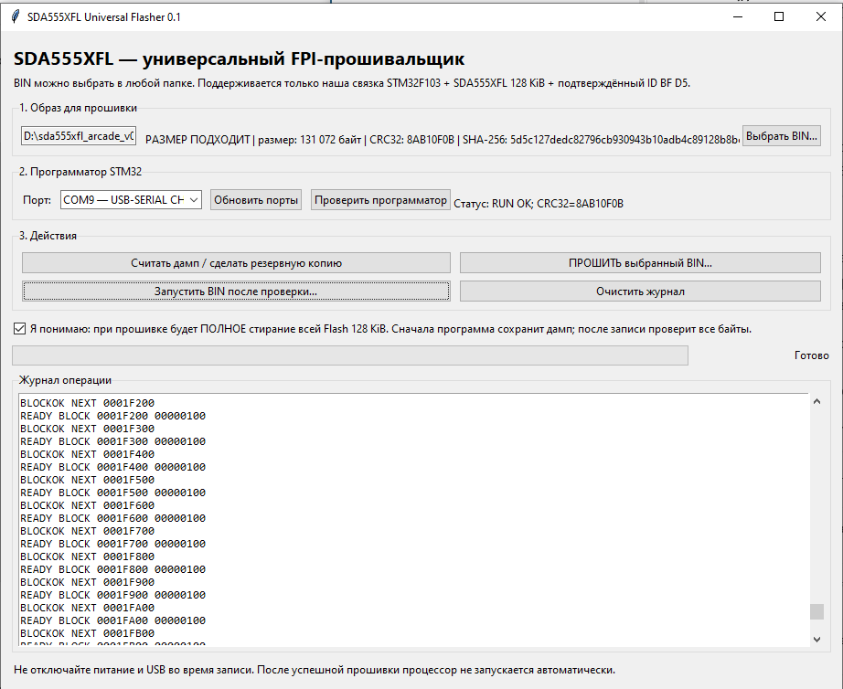
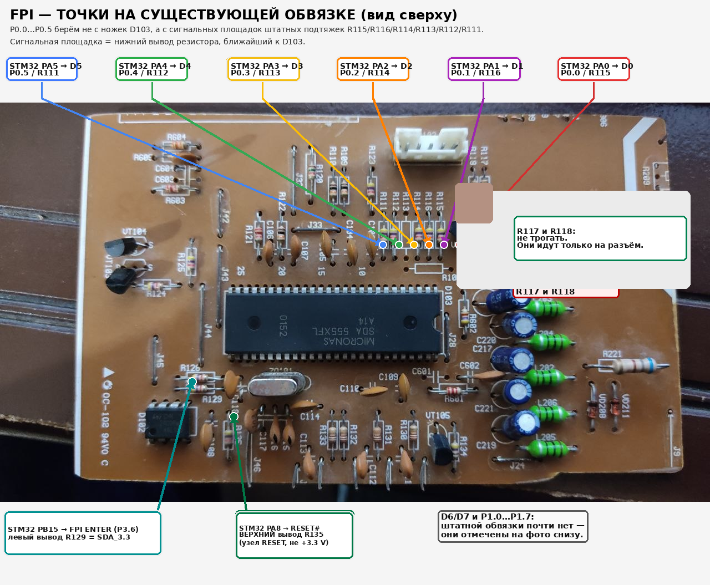
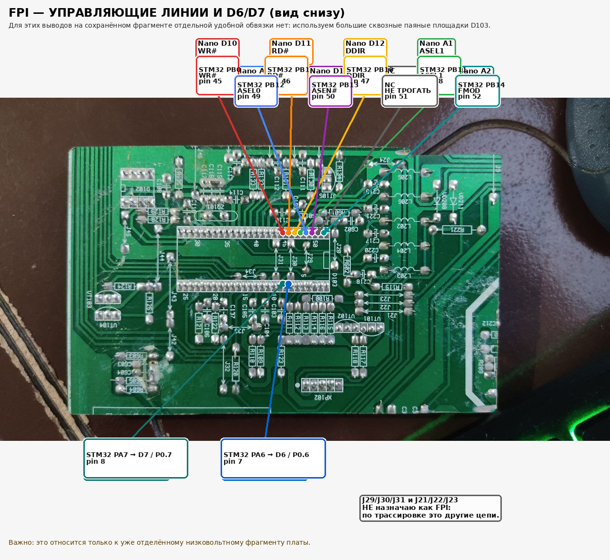
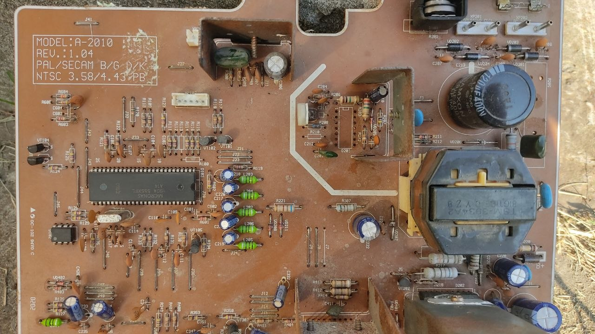
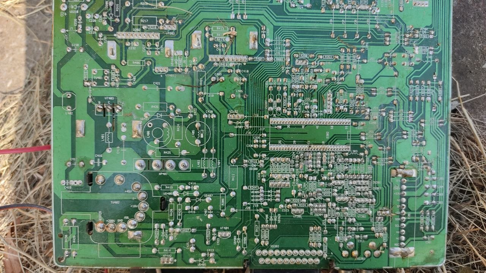
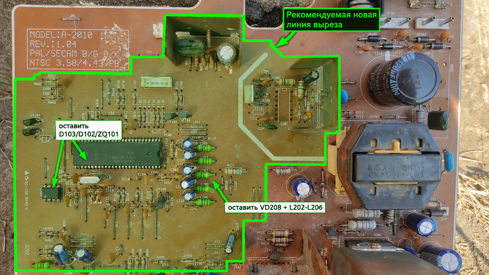

# SDA555XFL OSD Lab

**От обратной разработки телевизионного OSD к автономной графической и игровой платформе.**\
**From reverse-engineering a television OSD processor to a standalone graphics and retro-gaming platform.**

[Русский](#русский) · [English](#english) · [Документация / Documentation](#документация--documentation)

---

## Русский

SDA555XFL OSD Lab — аппаратно-программный исследовательский проект на базе телевизионного шасси **Sokol A-2010** и микросхемы **Micronas SDA555XFL A14 (PSDIP-52)**. Цель проекта — изучить встроенный OSD-процессор, формировать собственную графику, разработать интерфейс программирования Flash на STM32F103 и превратить телевизионную микросхему в небольшую автономную ретро-платформу.

### Видеообзор проекта

  
   
  <strong><a href="https://irman100.github.io/SDA555XFL-OSD-Lab/">▶ Смотреть видео во встроенном плеере проекта</a></strong>

Видео открывается в плеере на отдельной странице GitHub Pages проекта и начинается с отметки 00:26. README GitHub не поддерживает YouTube iframe напрямую, поэтому для воспроизведения без перехода на YouTube подготовлена отдельная страница просмотра. Чтобы опубликовать её, один раз включите GitHub Pages: **Settings → Pages → Deploy from a branch → Branch: main → Folder: /docs → Save**.

### Эволюция проекта

1. **Исследование платы:** документирование обеих сторон Sokol A-2010, штатных резисторных цепей, доступных площадок и механических ограничений.
2. **Reverse engineering OSD:** восстановление модели экранной памяти, Pointer Arrays, GDW, CLUT и DRCS.
3. **Автономный видеовывод:** собственные OSD-образы, тесты синхронизации и растровые символы.
4. **Собственный FPI:** переход к программатору на **STM32F103**, host-инструментам и проверкам образа.
5. **Интерактивная графика:** меню, управление ИК-пультом и Pong.
6. **Tetris / Arcade:** игровое поле, HUD, статистика фигур, NEXT и уровни.

### Платформа

| Подсистема | Текущая документация |
|---|---|
| Целевой чип | Micronas SDA555XFL A14, PSDIP-52 |
| Исходная плата | Телевизионное шасси Sokol A-2010 |
| Процессор | 8051-совместимое ядро |
| Встроенная Flash | До 128 КиБ |
| OSD | 40 × 25 ячеек; Character Display RAM 3000 байт |
| Графика | GDW, CLUT, DRCS |
| FPI | STM32F103 + host-side инструменты |
| Игры | IR Pong, Tetris / Arcade |

### Актуальный FPI

Текущая аппаратная конфигурация использует **STM32F103**. Актуальные сигналы и точки подключения приведены в [руководстве FPI / STM32F103](docs/STM32_FPI_CONNECTIONS_RU.md).

Надпись `Nano` на обратной фотографии STM32 сохраняется без ретуширования и кадрирования: это исторический след промежуточной итерации, а не актуальная распиновка. Источник текущего mapping — отдельная таблица STM32F103.

### Фотографии проекта

Оригиналы встроены ниже отдельными файлами и сохраняются в исходном разрешении. Они не заменены контактным листом, фотоматрицей или сжатым коллажем.

#### Tetris на настоящем CRT

#### Universal FPI Flasher 0.1

Этот экран показывает состояние программы и `RUN OK`, но сам по себе не доказывает полный физический цикл erase/program/read-back.

#### STM32F103 FPI — верхняя сторона

#### STM32F103 FPI — обратная сторона

#### Sokol A-2010 — компонентная сторона

#### Sokol A-2010 — сторона пайки

#### Исследование зоны выреза

Это предварительная исследовательская разметка, а не производственный размерный чертёж.

### Достоверность результатов

- **Measured** — измерено прибором.
- **Observed** — непосредственно видно на фото, видео или в логе.
- **Simulated** — проверено программной моделью.
- **Pending** — требует дополнительной аппаратной проверки.

Фотография Tetris подтверждает визуальный вывод OSD, но не заменяет измерения RGB/sync осциллографом. Скриншот Flasher не доказывает полный erase/program/read-back. Аппаратное поведение ИК-повтора и автогравитации требует отдельной проверки.

### Безопасность

- Заводской дамп и recovery-копии Flash не включаются в публикационный комплект.
- Разрушительные FPI-операции остаются заблокированными в стандартной конфигурации STM32F103 Engine v0.5.
- Не выполнять erase/program без отдельного разрешения, проверенной резервной копии и плана полного read-back.
- Разметка зоны выреза является исследовательской фотографией, а не размерным производственным чертежом.
- Репозиторий опубликован в открытом режиме Public; исходники и история проекта доступны посетителям GitHub.

## English

SDA555XFL OSD Lab is a hardware/software research project built around the **Sokol A-2010 TV chassis** and the **Micronas SDA555XFL A14 (PSDIP-52)**. The goal is to understand the built-in OSD processor, generate custom graphics, develop an STM32F103-based Flash Programming Interface, and turn a television IC into a small standalone retro-gaming platform.

**Project video:** [open the embedded project player](https://irman100.github.io/SDA555XFL-OSD-Lab/). Playback starts at 00:26 on the project's GitHub Pages site.

### Project progression

1. **Board investigation:** documenting both sides of the Sokol A-2010 PCB, resistor networks, accessible pads and mechanical constraints.
2. **OSD reverse engineering:** reconstructing display memory, Pointer Arrays, GDW, CLUT and DRCS.
3. **Standalone video:** custom OSD firmware, sync experiments and raster glyphs.
4. **Custom FPI:** moving to an **STM32F103** programmer, host tools and image validation.
5. **Interactive graphics:** a custom menu, IR remote control and Pong.
6. **Tetris / Arcade:** game board, HUD, piece statistics, NEXT preview and levels.

### Platform at a glance

| Subsystem | Project reference |
|---|---|
| Target IC | Micronas SDA555XFL A14, PSDIP-52 |
| Original board | Sokol A-2010 TV chassis |
| CPU | 8051-compatible core |
| Embedded Flash | Up to 128 KiB |
| OSD | 40 × 25 cells; 3,000-byte Character Display RAM |
| Graphics | GDW, CLUT, DRCS |
| FPI | STM32F103 and host-side tools |
| Games | IR-controlled Pong, Tetris / Arcade |

### Current FPI hardware

The current programmer interface is based on **STM32F103**. The authoritative signal mapping is documented in the STM32F103 FPI wiring reference.

The historical `Nano` label on the underside FPI photograph is intentionally retained. It is not the current pin map; the STM32F103 table is authoritative.

### Project photography

The seven photographs above are original project assets, preserved as separate full-resolution files. No contact sheet, low-resolution frame matrix or compressed collage replaces them.

The cutout image is a preliminary clearance study, not a dimensioned manufacturing drawing. The Flasher screenshot showing `RUN OK` is not, by itself, proof of a complete physical erase/program/read-back cycle.

### Evidence and safety

- **Measured** — verified with measurement equipment.
- **Observed** — directly visible in a photograph, video or log.
- **Simulated** — checked using a software model.
- **Pending** — still requires hardware verification.

Factory Flash dumps and recovery copies are excluded. Destructive FPI operations remain locked in the standard configuration. Do not erase or program Flash without explicit authorization, a verified backup and a complete read-back plan.

## Документация / Documentation

- `docs/PHOTO_GALLERY_RU.md` — фотогалерея и правила качества.
- `docs/PUBLICATION_ASSET_MANIFEST_RU.md` — оригиналы, размеры и SHA-256.
- `docs/PROJECT_PRESENTATION_RU.md` — структура 12-слайдовой презентации.
- `docs/PUBLICATION_RELEASE_CHECKLIST_RU.md` — выпускной чек-лист.
- `docs/STM32_FPI_CONNECTIONS_RU.md` — актуальные точки подключения STM32F103.
- `docs/index.html` — страница проекта со встроенным видеоплеером (GitHub Pages).
