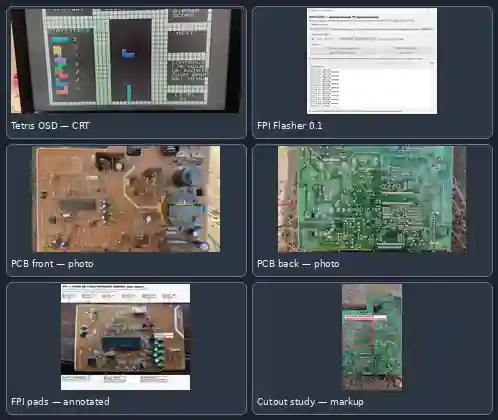

# SDA555XFL OSD Lab

**Reverse-engineering and standalone graphics experiments for the Micronas SDA555XFL TVText Pro processor from a Sokol A-2010 television.**

The project explores the processor's built-in 8051-compatible core, OSD/display generator, RGB and sync outputs, embedded 128 KiB Flash, and Flash Programming Interface (FPI). The goal is to turn a television text/OSD processor into a small standalone graphics and retro-game platform while preserving a reproducible, safety-conscious hardware workflow.

[Русская версия](README_RU.md) · [Project status](docs/PROJECT_STATUS_RU.md) · [Technical overview](docs/PROJECT_OVERVIEW_RU.md) · [Verification matrix](docs/VERIFICATION_MATRIX_RU.md)

## What has been built and investigated

### 1. SDA555XFL reverse engineering
- Identified the target as **SDA555XFL A14, PSDIP-52**, from the Sokol A-2010 TV chassis.
- Recovered the factory OSD memory layout and pointer structures.
- Established the 40 × 25 character display geometry: 1,000 cells, 3 bytes per cell, 3,000 bytes of display RAM.
- Mapped pointer arrays, Global Display Word (GDW), programmable character areas (DRCS), and the colour lookup table (CLUT).
- Reconstructed a 12 × 10 raster glyph for standalone OSD experiments.

### 2. Video output and display experiments
- Mapped PSDIP-52 pins: H-sync 19, V-sync 20, RGB 38/39/40, BLANK/COR 41.
- Standalone bench work recorded approximately **15.625 kHz H-sync** and **50 Hz V-sync**.
- A project photograph from 1 November 2026 shows custom Tetris OSD rendered on a CRT television. This is visual evidence of an image on the display, not a substitute for measuring RGB amplitude, sync margins, or long-term stability.

### 3. FPI and STM32F103 programmer
- Developed an STM32F103-based interface for the SDA555XFL Flash Programming Interface.
- Investigated the JEDEC-style command path and non-destructive device identification. The programmer workflow reports device ID **BF D5**.
- Built host-side tools for image validation, 128 KiB transfer planning, block CRC checks, and read-back verification.
- The documented STM32F103 Engine v0.5 is **compile-locked for destructive operations by default** (ALLOW_DESTRUCTIVE_FPI=0). Its software simulation passed; this is not proof of a destructive write on the physical target.
- The latest Universal FPI Flasher 0.1 screenshot shows a 131,072-byte image, CRC32 8AB10F0B, and RUN OK host/programmer status. The screenshot alone does not prove that a complete chip write and full read-back finished.

### 4. Standalone software and games
- Built standalone OSD test firmware and instruction-level verification for the 8051-compatible core.
- Created Pong with IR-remote input and a custom on-screen menu/test environment.
- Developed the Tetris/Arcade line with a custom HUD, piece statistics, NEXT panel, board geometry, gravity and repeat-control experiments.
- The latest documented Arcade image is **v0.22 for P3.3**, 128 KiB, CRC32 8AB10F0B, SHA-256 5d5c127dedc82796cb930943b10adb4c89128b8bcc29b107e7e98d8eeae476ad. Helper-level tests pass, but complete CPU/IR emulation and final physical control-timing validation remain open.

## Repository map

| Path | Contents |
|---|---|
| docs/history/ | Reverse-engineering notes, memory maps, sync experiments |
| firmware/experimental/v5/ | Standalone OSD v5 images, source and manifests |
| firmware/experimental/v6_no_shadow/ | Diagnostic no-shadow variants |
| programmer/stm32f103_engine_v0_5/ | STM32F103 FPI firmware, host tools, safety audit and simulation |
| docs/PROJECT_STATUS_RU.md | Current evidence and open questions |
| docs/PROJECT_OVERVIEW_RU.md | Project architecture and technical summary |
| docs/VERIFICATION_MATRIX_RU.md | Verified vs. not-yet-verified claims |
| assets/project-gallery.webp | Selected project photographs and clearly labelled annotations |

The v0.22 Arcade release notes and checksums are maintained in the [v0.22 release documentation branch](https://github.com/irman100/SDA555XFL-OSD-Lab/tree/release/arcade-v0.22-irwatchdog-autogravity-gray-pongline-p33-20261028/SDA555XFL_Arcade/v0.22-irwatchdog-autogravity-gray-pongline-p33-20261028). The standalone v0.22 BIN and ZIP are release artifacts from the development session; they are not included in this repository snapshot.

## Safety and scope

- The original factory 128 KiB ROM dump and recovery copies are intentionally kept outside the repository.
- The television service manual and third-party documents are not redistributed here.
- The v0.5 FPI engine defaults to compile-locked destructive operations. Do not remove the lock or issue erase/program commands without a separately reviewed target profile, a verified factory backup, and a complete read-back plan.
- RGB amplitude and analog signal quality must be measured with suitable equipment; a software gain setting is not an analog measurement.
- The board-clearance/cutout graphic in the gallery is an annotated planning reference, not a certified mechanical drawing.
- This repository remains **Private**. No open-source licence is granted by the current contents.

See the [current status](docs/PROJECT_STATUS_RU.md) before attempting any hardware operation.
