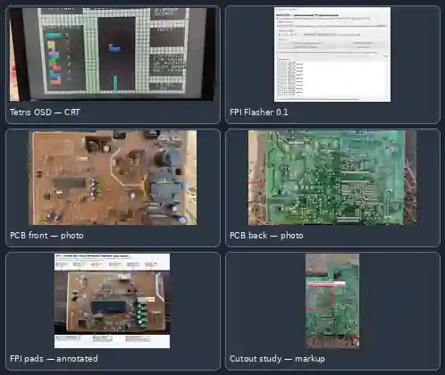

# SDA555XFL OSD Lab

**Исследование и разработка автономной графики для микропроцессора Micronas SDA555XFL TVText Pro из телевизора Sokol A-2010.**

Проект посвящён встроенному 8051-совместимому ядру, OSD-генератору, RGB- и sync-выходам, внутренней Flash объёмом 128 КиБ и интерфейсу Flash Programming Interface (FPI). Наша цель — превратить процессор телевизионного телетекста/OSD в небольшую самостоятельную графическую и игровую платформу, сохранив проверяемый и безопасный процесс аппаратных экспериментов.

[English README](README.md) · [Статус проекта](docs/PROJECT_STATUS_RU.md) · [Технический обзор](docs/PROJECT_OVERVIEW_RU.md) · [Матрица проверок](docs/VERIFICATION_MATRIX_RU.md)

## Что сделано

### 1. Обратная разработка SDA555XFL
- Определена целевая микросхема: **SDA555XFL A14, корпус PSDIP-52**, снятая с шасси телевизора Sokol A-2010.
- Восстановлена геометрия заводской OSD-памяти и таблицы указателей.
- Подтверждена геометрия экрана 40 × 25 символов: 1000 ячеек, по 3 байта на ячейку, всего 3000 байт Display RAM.
- Разобраны Pointer Arrays, Global Display Word (GDW), области программируемых символов DRCS и таблица цветов CLUT.
- Восстановлен растровый символ 12 × 10 и применён в автономных OSD-экспериментах.

### 2. Видеовывод и OSD
- Сопоставлены выводы PSDIP-52: H-sync — 19, V-sync — 20, RGB — 38/39/40, BLANK/COR — 41.
- В автономных измерениях зафиксированы приблизительно **15,625 кГц по H-sync** и **50 Гц по V-sync**.
- На фотографии от 1 ноября 2026 года виден собственный Tetris OSD, выведенный на CRT-телевизор. Это подтверждает наличие изображения на экране, но не заменяет измерение амплитуды RGB, запасов по синхронизации и длительной стабильности.

### 3. FPI и программатор STM32F103
- Разработан интерфейс на STM32F103 для работы с Flash Programming Interface SDA555XFL.
- Исследован JEDEC-подобный путь команд и неразрушающая идентификация микросхемы. В рабочем процессе программатора отображается ID **BF D5**.
- Подготовлены host-инструменты для проверки образа, планирования передачи 128 КиБ, CRC отдельных блоков и read-back.
- Документированная версия STM32F103 Engine v0.5 по умолчанию **заблокирована от разрушительных операций** (ALLOW_DESTRUCTIVE_FPI=0). Программная симуляция прошла успешно, но это не доказательство записи Flash на физической микросхеме.
- На свежем снимке Universal FPI Flasher 0.1 отображаются образ размером 131 072 байта, CRC32 8AB10F0B и статус RUN OK. Сам снимок не доказывает завершение полной записи микросхемы и полного чтения обратно.

### 4. Автономная прошивка и игры
- Созданы автономные OSD-тестовые образы и instruction-level проверка кода для 8051-совместимого ядра.
- Реализован Pong с управлением ИК-пультом и собственным экранным меню/тестовой средой.
- Развивается Tetris/Arcade: собственный HUD, статистика фигур, панель NEXT, геометрия поля, гравитация и повтор удерживаемых кнопок.
- Последний документированный Arcade-образ — **v0.22 для P3.3**, 128 КиБ, CRC32 8AB10F0B, SHA-256 5d5c127dedc82796cb930943b10adb4c89128b8bcc29b107e7e98d8eeae476ad. Тесты отдельных помощников проходят, но полной эмуляции CPU/ИК-приёмника и окончательной проверки реального времени повторов пульта ещё нет.

## Структура репозитория

| Путь | Содержимое |
|---|---|
| docs/history/ | Заметки обратной разработки, карты памяти и эксперименты с синхронизацией |
| firmware/experimental/v5/ | Автономные OSD-образы v5, исходники и манифесты |
| firmware/experimental/v6_no_shadow/ | Диагностические варианты без тени |
| programmer/stm32f103_engine_v0_5/ | Прошивка STM32F103 FPI, host-инструменты, аудит безопасности и симуляция |
| docs/PROJECT_STATUS_RU.md | Актуальные подтверждения и открытые вопросы |
| docs/PROJECT_OVERVIEW_RU.md | Архитектура и техническое описание |
| docs/VERIFICATION_MATRIX_RU.md | Что подтверждено, а что ещё нет |
| assets/project-gallery.webp | Фотографии проекта и отдельно обозначенные аннотации |

Документация последнего Arcade v0.22 находится в [ветке release v0.22](https://github.com/irman100/SDA555XFL-OSD-Lab/tree/release/arcade-v0.22-irwatchdog-autogravity-gray-pongline-p33-20261028/SDA555XFL_Arcade/v0.22-irwatchdog-autogravity-gray-pongline-p33-20261028). Сам BIN v0.22 и архивы — отдельные артефакты разработки; в этот снимок основного репозитория они не включены.

## Безопасность и границы проекта

- Оригинальный заводской дамп Flash 128 КиБ и резервные копии намеренно хранятся отдельно от репозитория.
- Сервисная документация телевизора и сторонние материалы здесь не распространяются.
- В FPI Engine v0.5 разрушительные операции по умолчанию заблокированы. Не снимайте блокировку и не запускайте erase/program без отдельной проверки профиля цели, проверенной заводской копии и полного плана read-back.
- Амплитуда RGB и качество аналогового сигнала должны измеряться подходящими приборами; программное значение усиления не является измерением аналогового выхода.
- Графика зоны выреза/зазора в галерее — аннотированная рабочая схема, а не сертифицированный механический чертёж.
- Репозиторий остаётся **Private**. Текущим содержимым открытая лицензия не предоставляется.

Перед аппаратными действиями см. [актуальный статус проекта](docs/PROJECT_STATUS_RU.md).
