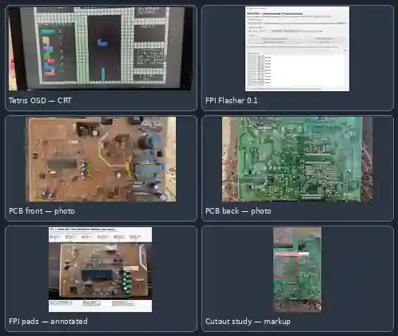

# Фотогалерея проекта

## Что изображено

1. **Tetris OSD на CRT, 01.11.2026.** Реальное фото экрана телевизора с собственной графикой Tetris, статистикой фигур, NEXT и панелью управления.
2. **Universal FPI Flasher 0.1.** Скриншот host-интерфейса: выбранный образ 131072 байта, CRC32 8AB10F0B, COM9 и статус RUN OK. Это не самостоятельное доказательство полного read-back.
3. **Sokol A-2010 PCB, component side.** Фотография оригинальной платы со стороны компонентов.
4. **Sokol A-2010 PCB, solder side.** Фотография обратной стороны платы.
5. **FPI contact map.** Аннотированное фото существующих контактных площадок на лицевой стороне. Подписи и цветные линии добавлены для анализа.
6. **Cutout / clearance study.** Аннотированное изображение зоны зазора/выреза. Это рабочая разметка поверх фотографии, не размерный чертёж и не подтверждение фактической геометрии после обработки.

## Происхождение изображений

Фотографии телевизионного экрана, программатора и платы предоставлены владельцем проекта из личного архива. Аннотированные схемы показывают рабочую разметку, сделанную в ходе анализа. Внешние фотографии из каталогов и чужих сайтов в галерею не добавлялись.

Полноразмерные оригиналы остаются в пользовательской библиотеке; в GitHub добавлена оптимизированная галерея для README. Сервисная документация телевизора и оригинальный заводской ROM в репозиторий не копировались.
